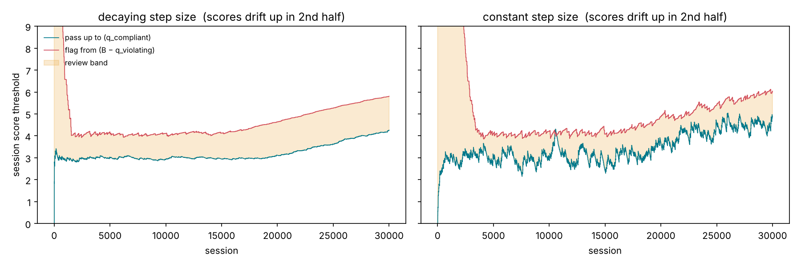

# ACI: conformal triage (flag / pass / review)

**Owner:** Áron · **Pipeline:** P6 (review and retraining) · **Paper:** A. N. Angelopoulos, R. F. Barber, S. Bates, *Online conformal prediction with decaying step sizes*, arXiv:2402.01139, 2024. It builds on I. Gibbs, E. Candès, *Adaptive Conformal Inference Under Distribution Shift*, NeurIPS 2021.

Decides for every agent session whether to **pass** it, **flag** it, or send it to **review**, with error rates you choose, and keeps those rates under drift.

## ACI explained

### 1. The question

DSPOT says "this one tool call looks suspicious". But someone still has to decide what to do with a whole **session**. ACI gives one of three answers per session:

- **pass**: it's fine, nobody needs to look at it
- **flag**: it's an attack, block it
- **review**: not sure, a human should look

And it does so with **error rates we choose in advance**, even when the data changes over time.

**Why ACI if we already have DSPOT?** DSPOT only raises alarms, while ACI makes the **final decision per session** (pass, flag or review), controls **both** errors (normal sessions bothered *and* attacks not flagged), and decides **which sessions a human sees**, at most one item each, so an alarm flood can't swamp the reviewers. DSPOT is the fast smoke detector; ACI is the method that decides what happens next.

### 2. Why the obvious answers fail

**Idea 1: "flag if the session score is above 4, pass if below 2".** Where do 2 and 4 come from? Every detector has its own scale, scores drift, and nobody can tell you how many normal sessions get flagged or how many attacks slip through.

**Idea 2: "train a classifier and flag if it says above 50% attack".** A classifier's 50% is often not a real 50%, especially for small or changing models. And it still gives no guarantee about error rates.

So we need lines that are set **by the error rates we want**, not by guessing, and that **keep correcting themselves**.

### 3. Choose the promises, not the lines

As with DSPOT, we flip the question. We choose two promises:

> **At most 5% of normal sessions** are not passed (flagged or sent to review).
> **At most 10% of attacks** are not flagged (passed or sent to review).

These are `ALPHA_NORMAL = 0.05` and `ALPHA_ATTACK = 0.1`. ACI then **finds and keeps** the two lines that fulfil them. Everything it isn't sure about goes to **review**, never silently through.

### 4. The key insight: a line that corrects itself

Think of a **thermostat**. It doesn't need to know the weather; it just reacts: too cold → heat a bit, too warm → heat less. ACI's lines work the same way (`domain/tracker.py`, `QuantileTracker.update`).

Take the "pass" line and a stream of labelled **normal** sessions. After each one:

- the session was **above** the line (we wrongly didn't pass it) → move the line **up** by `0.95 × step`
- the session was **below** the line (correctly passed) → move the line **down** by `0.05 × step`

"Up" steps are 19 times bigger than "down" steps. So the line comes to rest exactly where **5% of normal sessions are above it**: then the ups (5% × 0.95) and downs (95% × 0.05) cancel out.

The remarkable part: this works **without any assumption about the data**. Even if the scores jump around, or an adversary picks them, the long-run error rate is guaranteed to approach 5% (Theorem 1 of the paper).

### 5. Two lines, three answers

ACI keeps **two** self-correcting lines per agent (`domain/triage.py`):

- **"pass up to"**: learned from **normal** sessions, target 5%
- **"flag from"**: learned from **attack** sessions, target 10%

A session's suspicion `r` is its **highest anomaly score** (from the detectors in `DETECTORS`). With lines at 2.2 and 4.3:

```
0 ─────────── 2.2 ─────────── 4.3 ─────────── 20
     PASS      │    REVIEW     │     FLAG
          "pass up to"     "flag from"
```

| Session | r | Decision |
|---|---|---|
| normal email | 0.5 | **pass** |
| `send_email` attack | 5.9 | **flag** |
| odd but normal session | 3.1 | **review**: too odd to wave through, not clearly an attack |

If the lines cross (some scores fit both "normal" and "attack"), that overlap is also **review**. Technically, each line says whether a label is still possible, and ACI looks at the **set** of possible labels: {compliant} → pass, {violating} → flag, both or neither → review. This is called (class-conditional) conformal prediction.

### 6. Shrinking steps: the 2024 improvement

How big is a "step"? The original ACI (Gibbs & Candès, 2021) always uses the **same** step, so the line keeps wobbling forever, even when nothing changes.

The 2024 paper makes the steps **shrink over time**: `step = c · t^(-0.6)` (`QuantileTracker.eta`). An analogy is **tuning a guitar**: big turns of the peg first, then smaller and smaller ones until it's in tune.

- **Big steps at the start:** it learns quickly.
- **Tiny steps later:** it settles calmly at the right place. For stable data the paper proves it converges to the correct line (Theorem 3), which the constant step can't do.

**The trade-off:** when the data drifts, small late steps follow more **slowly**. The paper allows **resetting** the step size after a change, so resetting when a drift detector (S02 OPTWIN or S06 KSWIN) fires is a natural extension.

### 7. Where the labels come from: random audits

The lines learn from **labelled** sessions, i.e. a reviewer said "normal" or "attack". ACI picks a **random** 30% of **all** sessions (`AUDIT_RATE`), whatever it decided, and sends them to the review queue as **audits** (`service.py`). It learns **only** from these.

Why random, and not just the "review" sessions? The review sessions are all borderline ones. Learning only from them is like learning what a normal day looks like from only the strange days. A random sample shows the real picture, so the promises hold for **all** sessions.

**Safe start:** at the beginning both lines are at the "everything goes to review" position. As audit answers arrive, the review band narrows.

### 8. Session timing and agents

- ACI collects every score of a session and waits until the agent reports `session.ended`, plus 2 seconds for late scores (`GRACE_SECONDS`), then decides (`ACIService.tick`).
- **Each agent gets its own pair of lines**, because Agent A and Agent B behave differently.
- Every decision goes to `flags`. Review decisions and audits also go to `review-queue`: at most **one item per session**, which keeps the reviewers' workload bounded.

### 9. What we found

| Step size | Normal not passed (≤ 5%) | Attacks not flagged (≤ 10%) | Line jitter |
|---|---|---|---|
| shrinking (2024) | 5.2% | 8.8% | 0.13 |
| constant (2021) | 5.3% | 9.7% | 1.47 |

- **Both keep the promises; the shrinking steps are about 10× calmer.**
- **Under drift** the shrinking steps follow more slowly (7.5% instead of 5%).
- **Rare attacks learn slowly:** with 5% attacks, the "flag from" line gets few examples. In the end-to-end run no attack passed silently, but more of them went to review instead of flagged than promised. The promise holds *in the long run*, and rare classes take longer.
- **Review load vs. learning speed:** more audits make ACI learn faster but cost reviewers more time.

### 10. The whole thing in one picture

```
scores of a session ──► highest score r ──► session ended (+2 s)
                                                │
                     ┌──────────────────────────┴──────────────────────────┐
                     ▼                                                     ▼
          r ≤ "pass up to" only → PASS        r ≥ "flag from" only → FLAG      otherwise → REVIEW
                     │                                                     │
                     └───────── random 30% of all sessions: AUDIT ─────────┘
                                                │
                                   reviewer: normal / attack
                                                │
                          normal → nudge "pass up to"   attack → nudge "flag from"
                          (steps get smaller over time)

```

## Status

- [x] Decaying-step online conformal threshold (`domain/tracker.py`)
- [x] Class-conditional triage per agent (`domain/triage.py`)
- [x] Kafka service: session scores in, decisions out, learning from audits (`service.py`, `main.py`)
- [x] Offline evaluation, decaying vs constant step size (`evaluate.py`)

## How it works

A session's suspicion `r` is the highest anomaly score of its tool calls (detectors in `DETECTORS`), clipped to `[0, B]`. Two online thresholds per agent form a prediction set over {compliant, violating}:

| Set | Condition | Decision |
|---|---|---|
| {compliant} | `r ≤ pass_up_to` only | **pass** |
| {violating} | `r ≥ flag_from` only | **flag** |
| both, or neither | in between | **review** |

Each threshold follows eq. 4 of the paper, `q ← q + η_t (err_t − α)`, with decaying steps `η_t = c · t^(−1/2−ε)` (default `c = B/10`, `ε = 0.1`):

- `pass_up_to` learns from **normal** sessions with `α_normal`: at most 5% of normal sessions are not passed (flagged or reviewed).
- `flag_from` learns from **attack** sessions with `α_attack`: at most 10% of attacks are not flagged (passed or reviewed).

These hold in the long run for any sequence of scores (paper, Theorem 1). For stable data, the thresholds converge to the true quantiles (Theorem 3), which a constant step size cannot do.

**Safe start:** both thresholds start at 0, so every session is reviewed at first. The review band narrows as labels arrive.

**Audits:** labels come from the review queue. ACI sends a random 10% of **all** sessions (`AUDIT_RATE`) to review as audits, and learns **only** from those. Learning from the review band alone would be biased, since those sessions were already uncertain. This is also the "sampled review" safeguard of the design.

## Results (synthetic, `python -m aci.evaluate`)

Normal score ~ Exp(1), attack ~ 4 + Exp(1), 10% attacks, 30% audited, measured after the first 6000 sessions:

| Step size | Normal not passed (target ≤ 5%) | Attack not flagged (target ≤ 10%) | Attacks passed | Review share | Threshold jitter |
|---|---|---|---|---|---|
| decaying | 5.2% | 8.8% | 0.0% | 4.0% | 0.13 |
| constant (ACI 2021) | 5.3% | 9.7% | 0.04% | 4.2% | 1.47 |

With drift (all scores rise by 2 during the second half, `--drift`):



The decaying step is **ten times steadier** but **slower to follow drift**: under drift, 7.5% of normal sessions were not passed, against the 5% target. The constant step follows drift but jitters. The paper's Theorem 2 allows **resetting** the step size after a change, keeping the guarantee. Resetting when a drift detector (OPTWIN or KSWIN) fires is a natural extension.

## Kafka service

Reads `tool-calls.A`, `tool-calls.B` (session ends; Agent A's real events arrive there through the `agent-a-adapter`), `scores` and `labels`. After `session.ended` it waits `GRACE_SECONDS` for late scores, then publishes `decision.made` (Agent A's envelope) to `flags`. Review decisions and audits also go to `review-queue`.

```json
{"event_type": "decision.made", "session_id": "…",
 "data": {"scored_event_id": "<session.ended event id>", "agent_id": "B", "detector": "aci",
          "decision": "review", "prediction_set": [], "session_score": 4.7, "scores_seen": 3,
          "pass_up_to": 2.9, "flag_from": 5.1, "audit": false}}
```

Configuration is through environment variables: see `main.py`.

## Run the evaluation and tests

```bash
cd services/stream-processing/s10-aci
pip install -e ".[test]"
pytest
python -m aci.evaluate --drift --plot aci.png
```
